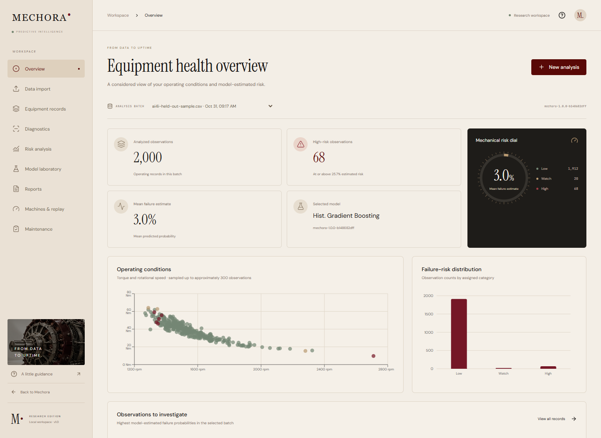
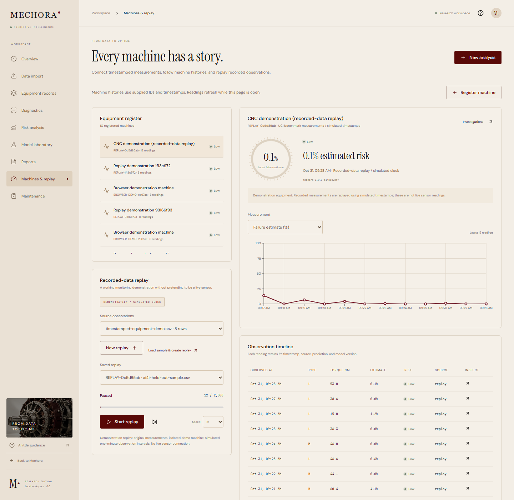

# Mechora AI

A local predictive-maintenance research application with an editorial industrial website, nine analytical workspaces, real scikit-learn inference, SQLite persistence, and PDF/CSV exports.

Built for a **course demonstration and portfolio showcase**, with no login. Follow `docs/DEMO.md` for the presentation walkthrough.

The website includes a custom **Mechora M monogram favicon**, with the same burgundy, cream, and brass palette as the interface. SVG, multi-size ICO, and Apple touch icons are included for browser tabs, bookmarks, and saved home-screen shortcuts.

**Equipment integration:** Machines & replay adds timestamped histories and recorded-data playback; Maintenance tracks inspections and confirmed outcomes; Model laboratory trains and evaluates supplied labeled data. CSV/HTTP, MQTT, and OPC UA adapters are included. See `docs/INTEGRATIONS.md` for setup and the complete workflow.

## Start the application

Requirements: Node.js 20.9+ and standard CPython 3.12+ (use python.org Python on Windows, not MSYS Python). No GPU, API key, paid service, or live sensor is needed.

The workspace already contains the installed dependencies and trained model. On this machine, start these in two terminals:

**Terminal 1 — prediction service**

```powershell
cd D:\Mechora-AI
.\.venv-win\Scripts\python.exe -m uvicorn backend.app.main:app --host 127.0.0.1 --port 8001
```

**Terminal 2 — website (keep Terminal 1 running)**

```powershell
cd D:\Mechora-AI
npm run dev
```

Open **[Mechora AI](http://127.0.0.1:3000)** or go straight to the **[workspace](http://127.0.0.1:3000/dashboard)**. Interactive API documentation: **[127.0.0.1:8001/docs](http://127.0.0.1:8001/docs)**.

For a new checkout:

```powershell
py -3.12 -m venv .venv-win
.\.venv-win\Scripts\python.exe -m pip install -r backend\requirements-lock.txt
npm ci
.\.venv-win\Scripts\python.exe -m backend.ml.train
```

On macOS/Linux, use `python3 -m venv .venv`, `.venv/bin/python`, and the equivalent forward-slash paths. After setup, Windows users can alternatively start both services with `powershell -ExecutionPolicy Bypass -File scripts\start.ps1`. The dev server binds only to loopback. Set `BACKEND_URL` before building if your backend is elsewhere; update the backend's allowed origins if changing the frontend port. If the website opens but shows a connection error, check that Terminal 1 is running on port 8001.

## Three views of the application

### Landing page — the concept and workflow


### Overview — a saved batch of predictions



### Machines & replay — equipment history and recorded-data playback



These are screenshots of the running application. Equipment replay is explicitly a demonstration with a simulated clock.

## Features, page by page

### 1. Landing page · `/`

Introduces the project, the analysis workflow, and the model's limits. **Analyze equipment** opens Data import; **Open workspace** opens Overview; **See how it works** opens a workflow guide. The numbered navigation links jump between sections.

Expandable insight rows explain conditions, risk estimates, and model explanations. The generator's **+ markers** reveal an illustrative measurement and its context; selecting the active marker closes it. The miniature dashboard is an illustrative preview; actual predictions appear in the workspace. Markers explain measurements and do not diagnose component faults.

### 2. Overview · `/dashboard`

Summarizes the selected saved analysis: observation count, high-risk count, mean predicted failure probability, and the model version used. A risk dial and category counts show how records are divided into **Low**, **Watch**, and **High**. Counts describe operating records, not necessarily unique machines.

Charts show torque against rotational speed, risk-category counts, process-temperature distribution in Celsius, and average risk by L/M/H product type. The scatter plot samples up to approximately 300 observations. A ranked table opens Diagnostics, and analysis history lets you revisit earlier batches.

### 3. Data import · `/import`

Accepts your CSV or the built-in **2,000-row held-out sample**. Download the sample to inspect its format, or select **Use sample dataset**. The importer checks required columns, missing or invalid values, units, and product types, and shows a preview before analysis.

**Run analysis** sends every valid observation through the trained model and saves the results. Optional machine identifiers and timestamps also create equipment histories. The original six-column CSV works without machine context.

### 4. Equipment records · `/records`

Lists the selected batch's six input measurements, estimated probability, and risk category. Search by observation or machine, filter by risk and product type, sort by probability, observation ID, torque, or speed, and move through paginated results.

Select an observation to open Diagnostics. **Export CSV** downloads the complete batch, including records beyond the current page. Observation IDs identify rows within an analysis; supplied machine IDs identify equipment.

### 5. Diagnostics · `/diagnostics`

Inspect a saved observation or enter all six inputs for a temporary **what-if** estimate. Results show probability, risk category, boundaries, and model version. Editing a what-if input clears the previous result until you run it again.

Numeric sensitivity bars show how the estimate changes when one measurement is replaced by its training median. Each value is compared with the training data's 5th–95th percentile range. A separate **L/M/H comparison** holds all five numeric measurements fixed and changes only product type; variants absent from a supplied model's training data are marked unvalidated.

Saved observations can be **flagged for inspection**, opening Maintenance. These explanations describe model behavior; they are not causal explanations or forecasts of when a machine will fail. What-if estimates are temporary and do not become saved equipment readings.

### 6. Risk analysis · `/risk-analysis`

Shows the distribution of estimated probabilities and lets you adjust **Watch** and **High-risk** boundaries. Watch must stay below High. **Apply & save analysis** creates another saved analysis while preserving the original results. Changing category boundaries groups predictions; it does not retrain the model.

Validation-set precision, recall, false positives, and missed failures illustrate the tradeoff at the nearest evaluated high-risk boundary. The page also shows the selected model's test precision–recall curve, average risk by type, and higher-risk observations. Evaluation scores come from labeled evaluation data, not unknown outcomes in your uploaded CSV.

### 7. Model laboratory · `/models`

Documents the active model, data split, preprocessing, classification boundary, and provenance. Compare **Logistic Regression**, **Random Forest**, and **HistGradientBoosting** on validation data, then inspect the selected model's separate test scores, confusion matrix, ROC and precision–recall curves, and global permutation feature importance.

The training studio accepts your labeled CSV and supports **later-observation holdout**, **different-machine holdout**, or a **stratified random split**. It shows training progress, split sizes, validation comparisons, and test scores. Training creates a candidate; **Use this trained model** explicitly activates it for new predictions. Previously used models can be restored. Earlier analyses retain their original archived model and explanations.

Training requires at least 100 rows, at least 10 examples of each outcome, and both outcomes in every partition. These are software minimums, not proof of adequate industrial evidence. See the [integration guide](docs/INTEGRATIONS.md) for each split's requirements.

### 8. Reports · `/reports`

Choose a saved analysis and **Generate PDF report**. The PDF includes dataset provenance, model version, risk boundaries, summary statistics, up to 100 observations ranked by estimated risk, and interpretation limits.

**Download results CSV** exports all observations and predictions. The report library keeps earlier PDFs available after refreshing the page. Reports use the original saved analysis metadata, even after a different model is activated.

### 9. Machines & replay · `/machines`

Register stable machine IDs, names, and optional locations. Select equipment to see its latest prediction, source, model version, and timestamp. Switch the trend between failure estimate, process temperature, rotational speed, torque, and tool usage. The chart uses up to 200 recent readings; the timeline lists the latest 30 and links each reading to Diagnostics.

The **recorded-data replay** uses an imported dataset or the sample. Create a replay, start or pause it, advance one observation, change playback speed, and restore a saved replay after navigation. Each run has a separate demonstration machine. Playback runs on the backend; its one-minute observation intervals use a **simulated clock**, not authentic source chronology.

Real supplied measurements can arrive through CSV/HTTP, MQTT, or OPC UA adapters. Successful ingestion saves a timestamped prediction in the same machine history. No physical machine is connected by default.

### 10. Maintenance · `/maintenance`

Turns a flagged saved observation into an investigation linked to its original measurements and prediction. Add inspection notes, filter investigations, move work between **Open**, **In progress**, and **Resolved**, and retain a status/note timeline. Resolving requires an inspection note and an outcome; investigations can be reopened.

Outcomes include **confirmed failure**, **no fault found**, **maintenance performed**, and **inconclusive**. **Export confirmed outcomes** includes resolved, non-replay cases explicitly labeled failure (1) or no fault (0), for further review and training. Preventive maintenance and inconclusive findings do not automatically become failure labels. Human-entered outcomes still require supporting evidence.

## Demonstration

1. Open the landing page and select **Analyze equipment**.
2. Select **Use sample dataset**. This imports the 2,000 held-out test feature rows; no labels are passed to inference.
3. Review the preview, schema validation, and count; select **Run analysis**.
4. Open **Equipment records**, filter to **High**, and inspect an observation.
5. Review the operating measurements and median replacement sensitivities in **Diagnostics**.
6. Open **Model laboratory** to compare validation metrics and inspect the selected model's separate test evaluation.
7. In **Risk analysis**, change boundaries and save a new analysis. Previous batches remain intact.
8. Flag a saved observation for inspection and add a note in **Maintenance**.
9. Open **Machines & replay**, load the sample, and step or play recorded observations.
10. In **Reports**, generate and download a PDF or export every result as CSV.

All saved batches, imported datasets, and report metadata are in `backend/data/mechora.db`. What-if single predictions are intentionally temporary. Record IDs identify rows within a batch, not persistent pieces of equipment. Repeated imports are not new independent evaluation experiments.

## Reproducible ML

```powershell
.\.venv-win\Scripts\python.exe -m backend.ml.train
```

The source CSV is included at `datasets/ai4i2020.csv`. Training uses seed 42 and a stratified 60/20/20 split. Only six operating features enter the pipeline. Product ID, UDI, Machine failure, TWF, HDF, PWF, OSF, and RNF are excluded. Preprocessing is fitted only on training records. Three models are compared by validation average precision. Each classification threshold maximizes validation F1. The best model is evaluated once on the untouched test set; no refitting on validation or test rows occurs.

Generated files:

- `artifacts/model.joblib`: trusted local model, reference medians, and metadata.
- `artifacts/metrics.json`: full comparison, evaluation curves, threshold tradeoffs, inspection, feature importance, and provenance.
- `artifacts/evaluation.png`: evaluation plots.
- `public/sample-observations.csv`: test-feature-only demonstration data.

For this run, HistGradientBoosting was selected. Test precision, recall, and F1 are each **0.7647**; ROC-AUC is **0.9716**; average precision is **0.8254**. These are measurements of this synthetic-data experiment, not claims of industrial effectiveness. Full methodology and results: `docs/PROJECT.md` and `artifacts/metrics.json`.

## Input schema

Every prediction considers all six features: **L/M/H product quality variant**, **air temperature (K)**, **process temperature (K)**, **rotational speed (rpm)**, **torque (Nm)**, and **tool usage (minutes)**. Product type is not an arbitrary machine category, and tool usage is not the age of the machine.

Required CSV header:

```csv
Type,Air temperature [K],Process temperature [K],Rotational speed [rpm],Torque [Nm],Tool wear [min]
M,298.1,308.6,1551,42.8,0
```

Short aliases are supported: `type`, `air_temperature`, `process_temperature`, `rotational_speed`, `torque`, `tool_wear`. No arbitrary column mapper is needed for these two explicit schemas. Extra columns are reported and excluded. All required values must be complete, finite, numeric where appropriate, and within documented broad validation ranges. Type is L/M/H, and process temperature must be at least air temperature. Uploads are limited to UTF-8 CSV, 5 MB, and 10,000 observations. Ranges reject malformed input; they are not engineering operating limits. See `backend/ml/schema.py`.

For equipment histories, supply **both** `machine_id` and timezone-aware `observed_at`:

```csv
Type,Air temperature [K],Process temperature [K],Rotational speed [rpm],Torque [Nm],Tool wear [min],machine_id,observed_at
M,298.1,308.6,1551,42.8,20,CNC-01,2026-10-31T09:00:00Z
```

Training CSVs also need a confirmed binary **`Machine failure`** label. Machine identifiers, timestamps, product identifiers, and target/failure-mode columns never enter the predictor.

## Connect it to real equipment

The working path is **measurement → connector → saved prediction → equipment history → inspection → confirmed outcome → model evaluation**.

Send a measured record to `POST /api/ingestion/readings`, or forward timestamped CSV observations:

```powershell
.\.venv-win\Scripts\python.exe scripts\connector.py csv path\to\measurements.csv
```

Optional MQTT and OPC UA adapters need their protocol packages:

```powershell
.\.venv-win\Scripts\python.exe -m pip install -r backend\requirements-connectors.txt
```

Map all six inputs to the actual process, preserve machine IDs and timestamps, and evaluate against confirmed equipment outcomes. Celsius sources can use the connector's explicit conversion option. The [integration guide](docs/INTEGRATIONS.md) includes full request examples, broker/server commands, node mapping, replay behavior, and retraining requirements.

## Tests and build

```powershell
.\.venv-win\Scripts\python.exe -m pytest backend\tests -q
.\.venv-win\Scripts\python.exe scripts\verify_model.py
npm run typecheck
npm run build
# With both services running and Chrome installed:
.\.venv-win\Scripts\python.exe scripts\e2e.py
.\.venv-win\Scripts\python.exe scripts\showcase_check.py
.\.venv-win\Scripts\python.exe scripts\integration_check.py
.\.venv-win\Scripts\python.exe scripts\landing_check.py
```

Integration tests use an isolated temporary SQLite database and never delete user analyses. Browser tests create real demonstration batches in the local workspace and write screenshots/downloads under ignored `output/qa/`. The default browser-test channel uses installed Google Chrome. You can use Playwright Chromium by removing `channel='chrome'` from the scripts after installing that browser.

The landing check verifies hero spacing and generator interactions across screen sizes and refreshes the three README images in `docs/images/`. Overview screenshots need at least one saved analysis; Machines & replay needs a prepared replay. Follow the walkthrough first if the workspace is empty.

Compiled local mode is `npm run build` followed by `npm start`, with FastAPI running separately. This is a local course/portfolio showcase without login and has not been published to external hosting.

## Project structure

```text
app/                   Next.js App Router routes and responsive styles
components/            Landing, workspace, chart, and brand components
lib/                   Typed API client and accessible dialog behavior
backend/app/           FastAPI endpoints and SQLAlchemy persistence
backend/ml/            Feature schema, training, evaluation, and explanations
backend/tests/         Integration and validation tests
datasets/              Original public dataset
artifacts/             Trained artifact and real evaluation outputs
public/                Optimized image, local fonts, inference sample
scripts/               Startup, browser tests, and asset preparation
docs/                  Academic project documentation and asset provenance
```

## Attribution and limitations

Dataset: Stephan Matzka (2020), *AI4I 2020 Predictive Maintenance Dataset*, UCI Machine Learning Repository, DOI: https://doi.org/10.24432/C5HS5C, CC BY 4.0. The training source is unchanged; the demonstration CSV removes labels/identifiers and selects held-out records.

Original machine imagery was generated for this project and optimized to WebP. Fonts are vendored with their SIL Open Font License files in `public/fonts`. See `docs/ASSETS.md`.

The benchmark dataset is synthetic. Random splits can benefit from shared simulated operating regimes. Equipment histories and measurement connectors are available when actual context is supplied; no physical machine is connected by default. No industrial savings, safety guarantee, component fault localization, remaining useful life, or time-to-failure predictions are claimed. Probabilities are not post-hoc calibrated. Local sensitivities are nonadditive, noncausal perturbations and may create unrealistic feature combinations. Real equipment studies need representative data and independent temporal/equipment validation.

Model IDs displayed by the API include an artifact fingerprint. The local `artifacts/models/` archive preserves the exact models needed for saved analyses. Reports read their original saved metadata; older results are never silently explained with a newer model. Back up this archive and `artifacts/experiments/` together with `backend/data/mechora.db`. Dependencies, local data, and model binaries are ignored by Git; a new checkout needs the setup/training commands above.

Further reading: [Project methodology](docs/PROJECT.md) · [Demonstration guide](docs/DEMO.md) · [Equipment integration](docs/INTEGRATIONS.md) · [Asset credits](docs/ASSETS.md).
