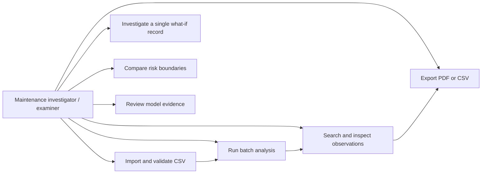
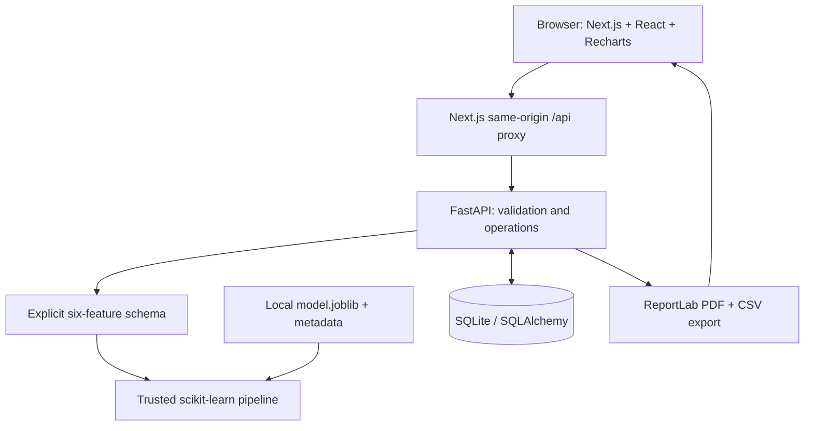
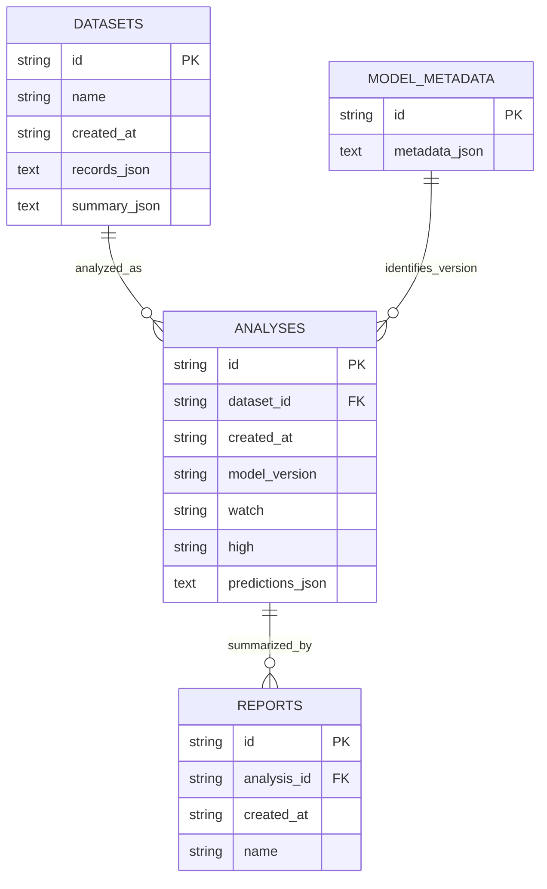
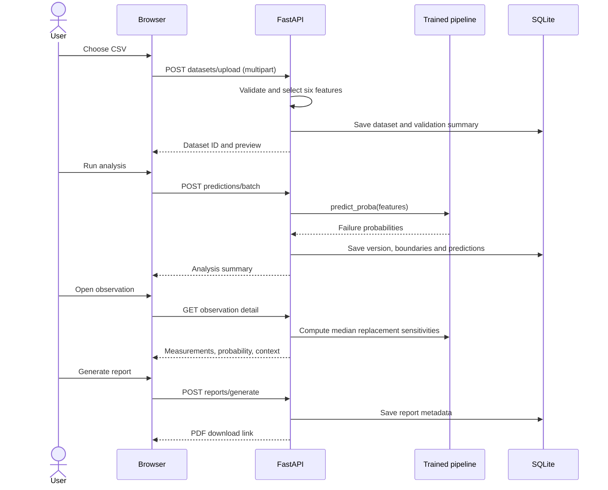

# Mechora AI — senior project technical report

## 1. Abstract

Mechora AI is a local, batch-based predictive-maintenance decision-support prototype. A Next.js interface accepts validated operating records; a FastAPI service applies a reproducible scikit-learn pipeline, persists the results in SQLite, and produces PDF/CSV reports. Three classical classifiers are compared on a public synthetic dataset. The website uses an industrial editorial identity, while the analytical interface prioritizes provenance, legible units, explicit thresholds, and honest limitations. The project demonstrates a complete software workflow rather than a validated factory deployment.

## 2. Problem statement

Operating measurements are difficult to interpret in isolation. Maintenance investigators need a consistent way to inspect conditions, prioritize records for further investigation, and understand the evidence behind an estimated risk. This project classifies the operating observation presented to it. The dataset does not support a defensible prediction of a future failure time or long-term history of a particular piece of equipment.

## 3. Objectives

- Implement reproducible supervised classification with leakage-resistant feature selection.
- Compare three lightweight CPU-based models using a consistent split and evaluation protocol.
- Validate CSV and single-record input and reject incomplete or malformed measurements.
- Persist batches, show searchable results, explain model sensitivities, and export findings.
- Provide a distinctive responsive interface, accessible controls, explicit errors, and reduced-motion support.
- Report actual measured performance and distinguish it from marketing illustration.

## 4. Scope

Included: a single-user local application, batch upload, single-observation what-if inference, configurable risk categories, real model evaluation, dataset previews, record filtering/sorting/pagination, observation diagnostics, analysis history, PDF summaries, CSV exports, and technical documentation.

Excluded: validated industrial deployment, ERP integration, billing, remaining useful life, component-level diagnosis, operational safety certification, and commercial multi-user hosting. Timestamped machine histories, CSV/HTTP/MQTT/OPC UA ingestion adapters, replay, maintenance investigations, and supplied-data training are implemented; see docs/INTEGRATIONS.md. The prototype requires independent real-world validation before any industrial use.

## 5. Literature context

Carvalho et al. [2] review machine-learning methods used in predictive maintenance. Their discussion of differing equipment and data settings supports treating a public dataset as an experimental starting point. It does not make a synthetic benchmark result transferable to a factory. Mechora therefore compares classical models on the same experimental protocol and documents the dataset boundary.

Zonta et al. [3] examine predictive maintenance in Industry 4.0, including integration challenges and the multidisciplinary character of the field. Mechora deliberately addresses a smaller batch-analysis problem. Connecting real sensors, establishing temporal outcomes, and integrating maintenance operations would require a separate research and engineering effort.

The UCI dataset documentation [1] supplies the feature and target definitions. Its explicit synthetic origin is central to interpreting this experiment. The project uses machine failure as the target; individual failure-mode flags describe outcomes and are excluded from inference. These sources motivate the design, not an assertion of demonstrated cost savings.

## 6. System requirements

Execution requirements: Node.js 20.9 or newer; standard CPython 3.12 or newer; a modern browser; CPU and local disk. Python package versions are captured in `backend/requirements-lock.txt`; frontend versions are locked in `package-lock.json`. No GPU or paid API is used. Network access is only needed to install dependencies or fetch the original dataset when it is absent; the working dataset, image, and fonts are included locally.

## 7. Functional requirements

1. Accept a UTF-8 CSV using the original AI4I feature header or six documented short aliases.
2. Validate the extension, size, row count, column uniqueness, feature availability, type values, finiteness, broad numerical ranges, and temperature order.
3. Display preview rows, record count, ignored columns, missing-value count, and duplicate-feature-row count.
4. Exclude target outcomes and identifiers from model input.
5. Generate deterministic failure probabilities and assign low/watch/high categories.
6. Save validated datasets and immutable analysis batches with model version and boundaries.
7. Search record IDs, filter type and category, sort measurements/probabilities, and paginate results.
8. Display individual measurements, risk, prediction time, training-distribution context, and numeric feature sensitivities.
9. Show validation comparisons separately from final selected-model test results.
10. Allow category-boundary changes by creating a new batch rather than overwriting a prior analysis.
11. Export a summary PDF and a complete CSV.
12. Provide OpenAPI documentation and clear recoverable errors.

## 8. Nonfunctional requirements

- Reproducibility: seed 42, explicit split protocol, recorded dataset digest, trusted artifact, and dependency locks.
- Integrity: probabilities come from a trained classifier, not UI fixtures; all six input fields are whitelisted.
- Persistence: committed SQLite data survives browser reload and server restart.
- Usability: responsive navigation, visible focus, reduced-motion support, tabular alternatives to charts, keyboard-operable dialogs and controls.
- Performance: bounded 10,000-row uploads, paginated record responses, limited scatter samples, optimized WebP imagery, local fonts, bounded numerical thread pools.
- Privacy: services bind to loopback; uploads remain in the local workspace. This is not a multi-user security model.
- Maintainability: typed frontend API, modular ML schema and training, integration tests, and documented data semantics.

## 9. Use cases

The investigator is a local user. No user roles, tenant boundaries, or administrative account flows are implied.

## 10. Architecture

The browser never loads Python artifacts. FastAPI never deserializes an uploaded model. Only the fixed project-local model path is loaded. React escapes user-facing text. The API uses ORM parameterization, bounded file reads, explicit origin checks for state changes, and validated values. Local-only service binding is intentional. External hosting would require a separate identity, security, storage, and operations design.

## 11. Database design

The model-version relation is logical; the current SQLAlchemy definition does not declare it as a database foreign key. Feature rows and prediction rows use bounded JSON documents rather than a separate relational row table. This reduces prototype complexity but duplicates feature values between imports and analysis batches. It is acceptable within the explicit 10,000-row batch limit; larger deployments should normalize observations and index prediction tables. Report metadata is persisted; PDF bytes are rendered on download from the immutable saved batch. The current report format is shared across downloads.

Observation IDs such as `OBS-00001` are deterministic row identifiers scoped to an analysis. They are not equipment identities. A stable dataset UUID and analysis UUID provide the surrounding provenance.

## 12. Data flow

## 13. ML methodology

The original source is `datasets/ai4i2020.csv`. A SHA-256 digest is saved in the model metadata. The sole target is `Machine failure`; features are Type, Air temperature [K], Process temperature [K], Rotational speed [rpm], Torque [Nm], and Tool wear [min]. UDI, Product ID, and five fault flags are excluded.

A stratified 20% test split is drawn with random state 42. A second stratified split allocates 25% of the remaining records to validation, giving 6,000 training, 2,000 validation, and 2,000 test records. Transformations use training data exclusively. Type uses dense one-hot encoding with unknown handling; numeric features use a median imputer and standard scaling. Imports require complete measurements; the imputer makes the training pipeline explicit rather than silently repairing user uploads.

Logistic Regression is the baseline (`class_weight='balanced'`, 2,000 maximum iterations). Random Forest uses 250 estimators, leaf size 2, and balanced-subsample weighting. HistGradientBoosting uses 200 maximum iterations, 15 leaves, learning rate 0.08, and L2 regularization 1, with the original class distribution. No resampling occurs. HistGradientBoosting retains its library-default training-only early stopping behavior. Parameters and preprocessing are visible in `backend/ml/train.py`.

Each algorithm's threshold is selected on validation data by maximizing F1 over the precision–recall thresholds. Selection between algorithms uses validation average precision. The selected fitted training-only pipeline is tested without refitting. The laboratory also supports separately supplied labeled data with temporal or disjoint-machine holdouts; these candidates require explicit activation. Threshold sweeps are computed on validation data, never on test data. A single random split is one experiment, not cross-validation or a confidence interval.

Global feature importance is validation-set permutation importance scored by average precision over five repeats with seed 42. Local explanation uses one numeric feature replacement at a time: the observed probability minus the probability when that feature is set to its training median. Positive values mean the observed feature increased the estimate relative to that replacement. Sensitivities are not additive, do not perturb product type, can create implausible combinations, and are not causal attributions.

Risk categories are explicit decision boundaries: low below watch; watch at or above watch and below high; high at or above high. The default watch boundary is half the validation-selected high boundary. This watch category is a UI prioritization heuristic, not a separately validated operational threshold.

## 14. Dataset description and inspection

The UCI AI4I 2020 dataset contains 10,000 synthetic process records. In this source, 339 records are labeled as machine failure (3.39%). Failure counts are 203 training, 68 validation, and 68 test. Type denotes product quality variants L, M, and H. Temperature fields are Kelvin, speed is rpm, torque is Newton-metres, and tool wear is minutes. Celsius is a display transformation only.

Data inspection, including missing counts, duplicate feature rows, target counts, and numeric correlations, is saved in `artifacts/metrics.json` under `inspection`. The public sample contains only the 2,000 test-feature records. It supports demonstrating inference without shipping target outcomes to the prediction API. It is not an additional independent validation dataset.

## 15. Model comparison

Validation measurements for the current saved run:

- Logistic Regression: precision 0.2946; recall 0.5588; F1 0.3858; ROC-AUC 0.8788; average precision 0.3680; threshold 0.775720.
- Random Forest: precision 0.7368; recall 0.6176; F1 0.6720; ROC-AUC 0.9680; average precision 0.6805; threshold 0.464028.
- HistGradientBoosting: precision 0.6618; recall 0.6618; F1 0.6618; ROC-AUC 0.9707; average precision 0.7297; threshold 0.256587.

HistGradientBoosting was selected because it had the highest validation average precision. Random Forest had slightly higher F1 at its selected classification threshold. This difference illustrates that model selection and decision-boundary selection answer different questions; the criterion is fixed and disclosed rather than changed after inspecting test results.

## 16. Final evaluation

Selected model on the untouched 2,000-record test set:

- Precision, recall, and F1: 0.764706 each.
- ROC-AUC: 0.971578.
- Average precision: 0.825365 (the UI labels this PR-AUC (AP); it is sklearn average precision, not trapezoidal integration).
- False positive rate: 0.008282.
- Brier score: 0.011747.
- Confusion matrix, actual outcomes in rows and predicted outcomes in columns: true negatives 1,916; false positives 16; false negatives 16; true positives 52.

The trained artifact stores raw curve points, validation threshold tradeoffs, and training distribution summaries. `artifacts/evaluation.png` provides ROC, precision–recall, and calibration plots. Inference latency is measured as amortized batch time per row on the training environment, not an end-user response-time service guarantee. Probabilities are not post-hoc calibrated. The reliability curve is shown rather than claiming absolute probabilities are industrially calibrated.

## 17. Testing methodology

Tests cover the full feature boundary and service workflow. Backend tests isolate a temporary SQLite file so user data is preserved. They inspect the artifact's input features, split sizes, selection criterion, and confusion-matrix count; check invalid schema and risk boundaries; and exercise real API requests with the trained classifier.

The browser test uses installed Chrome through Playwright. It begins on the landing page, navigates to import, uploads held-out observations, runs inference, filters records, inspects sensitivities, reviews model metrics, changes boundaries, reloads saved results, downloads both report formats, checks an invalid upload, searches and paginates records, and inspects six mobile routes plus mobile navigation. Browser-generated demonstration batches remain in the local application for review.

## 18. Recorded test results

- Backend: 37 tests passed, including independent metric reproduction, saved-model provenance, malformed CSV handling, threshold consistency, and older-analysis selection. One nonfailing upstream test-client deprecation warning was present.
- Frontend: TypeScript check passed and Next.js production build completed for the home page and nine workspace routes.
- Browser: complete import-to-report workflow passed with zero JavaScript page errors. Additional showcase checks verified in-flight predictions, clearing outdated results, restoring saved records, retrying temporary errors, drag-and-drop import, missing batches, and 404 recovery. All nine workspace routes passed at desktop (1440 px), tablet (768 px), and mobile (390 px) widths without document-level horizontal overflow.
- Dependency review: `npm audit --omit=dev --audit-level=high` reported zero vulnerabilities in the recorded dependency set.
- Visual review: desktop landing, mobile landing, dashboard, diagnostics, model laboratory, and rendered report were inspected. Screenshots and download evidence are under ignored `output/qa/`.

These results describe the recorded development checks; they do not establish complete WCAG conformance, load capacity, security certification, or performance on unseen industrial data.

## 19. Limitations

The dataset is synthetic and generated from a restricted simulation. Random splits can share nearby simulated operating conditions across sets; temporal/site-held-out evaluation would be stronger evidence of transfer. The model estimates a binary failure label for the submitted record, not a future failure time. The original benchmark lacks stable equipment identities. User-supplied IDs and timestamps support actual histories; replay uses explicit demonstration metadata. Absolute probabilities are not post-hoc calibrated. Thresholds are research priorities, never safety limits. Explanation perturbations can break feature relationships. The sample CSV is the test set's features, so repeated demos do not create independent evidence.

The application is local and single-user, uses bounded JSON batches in SQLite, does not implement accounts or deletion tooling, and has no production load benchmark. Very unusual but syntactically valid values may be outside the training distribution; diagnostics highlight the numeric 5th–95th percentile context. File validation ranges are intentionally broad sanity checks, not machine-specific operating specifications.

## 20. Future improvements

Future research should begin with representative factory data and a documented target horizon; temporal and site-held-out testing; uncertainty intervals; probability calibration using training/validation-only folds; stronger conditional explanations; and normalized observations for larger datasets. The current delivery is a course and portfolio showcase without login. Saved-model provenance across retraining is implemented through fingerprinted artifacts, archived models, and stored metadata. `docs/DEMO.md` describes the presentation flow.

## References

1. Matzka, S. (2020). *AI4I 2020 Predictive Maintenance Dataset*. UCI Machine Learning Repository. [Dataset and CC BY 4.0 attribution](https://doi.org/10.24432/C5HS5C).
2. Carvalho, T. P., et al. (2019). *A systematic literature review of machine learning methods applied to predictive maintenance*. Computers & Industrial Engineering, 137, 106024. [Publisher record](https://doi.org/10.1016/j.cie.2019.106024).
3. Zonta, T., et al. (2020). *Predictive maintenance in the Industry 4.0: A systematic literature review*. Computers & Industrial Engineering, 150, 106889. [Publisher record](https://doi.org/10.1016/j.cie.2020.106889).
4. Scikit-learn developers. [Model evaluation](https://scikit-learn.org/stable/modules/model_evaluation.html), [permutation importance](https://scikit-learn.org/stable/modules/permutation_importance.html), and [common pitfalls](https://scikit-learn.org/stable/common_pitfalls.html). Library documentation; implementation versions are locked in the repository.
